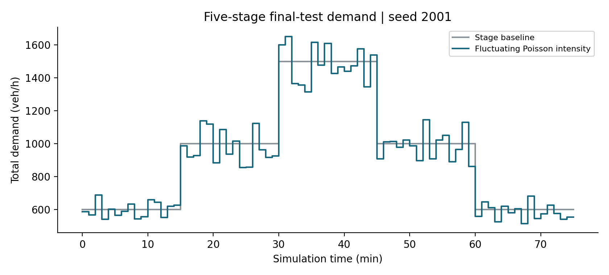
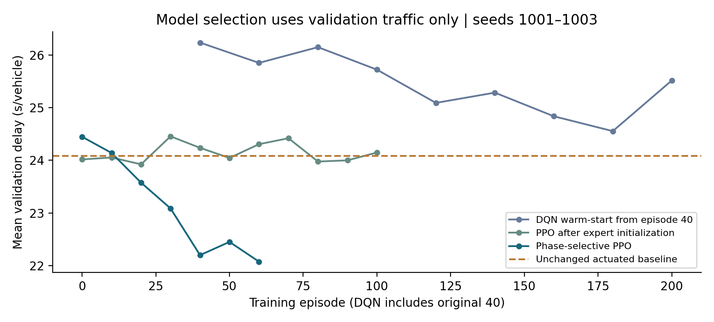
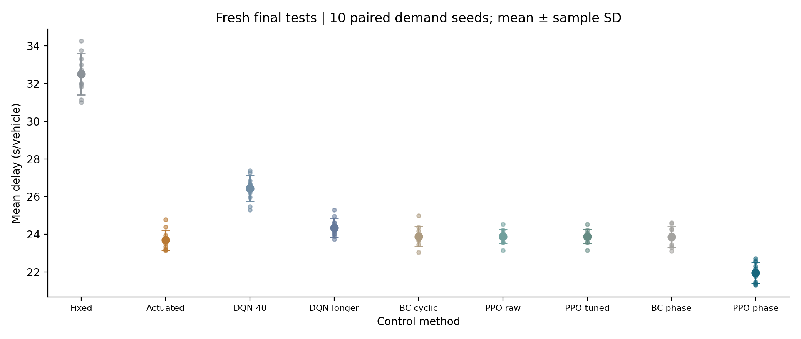
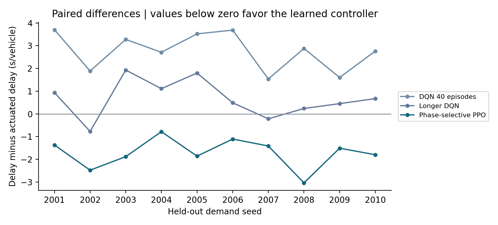
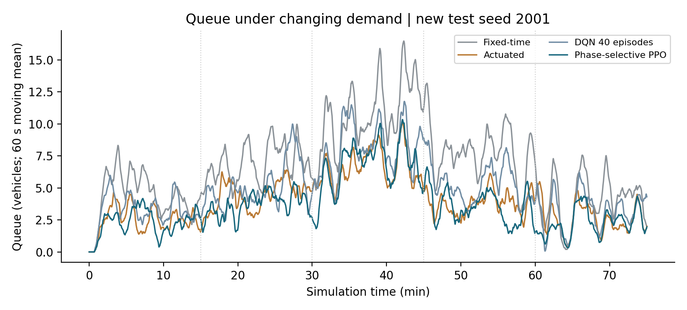
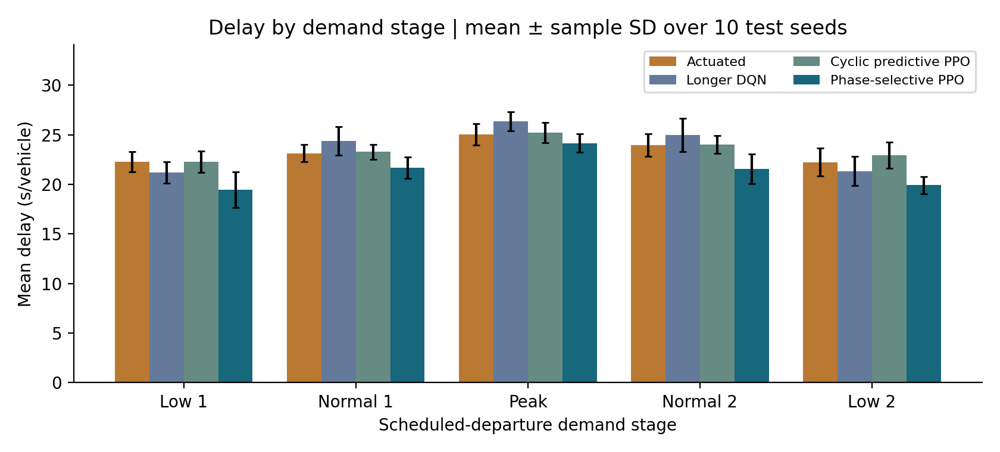
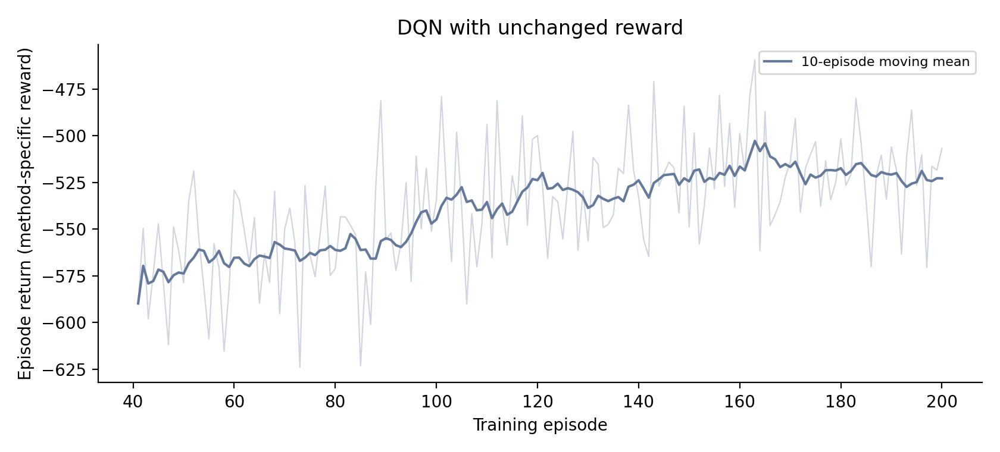
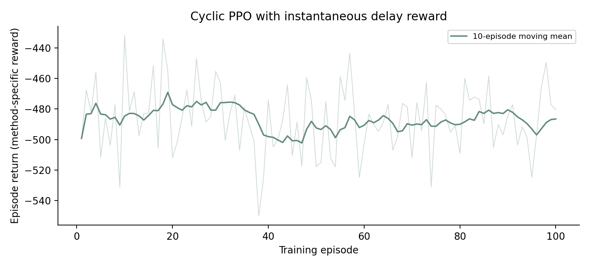
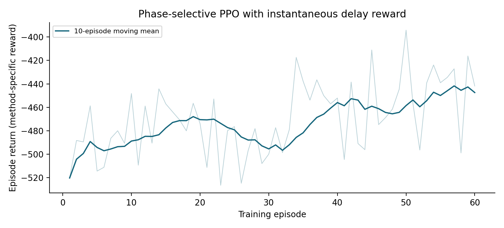
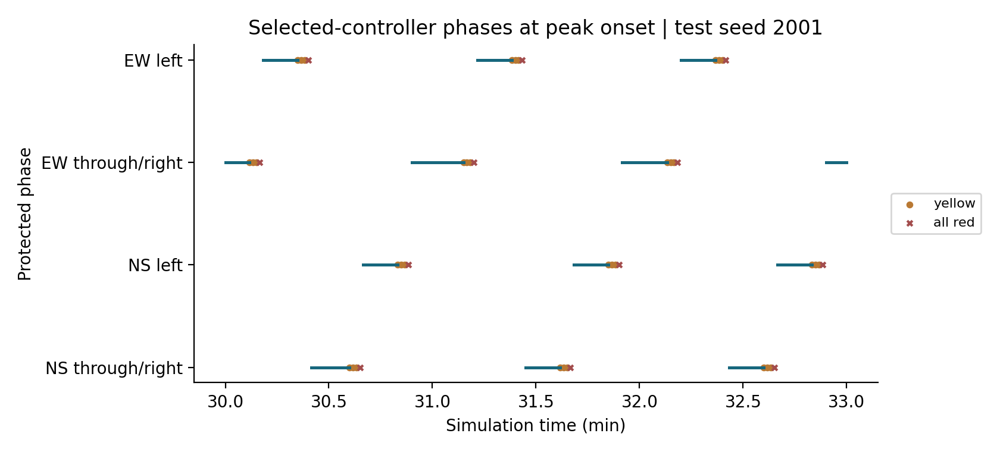

# 延长训练与信号控制优化报告

## 训练轮数与最终结论

延长训练有帮助，但不保证持续改善。原 40 轮模型在验证集上的平均延误为 26.235 s/veh，延长训练后的最佳验证均值为 24.554 s/veh，感应控制为 24.085 s/veh。累计训练到 200 轮后，按照验证结果选择第 180 轮模型，而非默认使用最后一轮。

预先依据验证集选出的最终方案是直接选相位 PPO。在 10 组新的测试车流上，其平均延误为 21.964 s/veh，感应控制为 23.689 s/veh，平均延误降低 7.28%。在 10/10 组种子上延误更低。

结果只适用于当前 SUMO 路口、交通分布和训练初始化。不得将验证集改善替换为最终测试结果，也不代表真实路口已验证。

- 定时控制：平均延误 32.503 s/veh。
- 感应控制：平均延误 23.689 s/veh。
- 原 40 轮 DQN：平均延误 26.444 s/veh。
- 长训练 DQN：平均延误 24.351 s/veh。
- 仅模仿初始化：平均延误 23.878 s/veh。
- PPO 未标定：平均延误 23.890 s/veh。
- 循环切相 PPO：平均延误 23.890 s/veh。
- 直接选相位的模仿初始化：平均延误 23.856 s/veh。
- 直接选相位 PPO：平均延误 21.964 s/veh。

## 训练量与控制方法的改进

长训练 DQN 从原 40 轮权重继续训练 160 轮，保持原 5 s 决策间隔、296 维输入、信号约束和奖励定义。由于原始优化器和回放池未保存，本次重新建立 Adam 和回放池，探索率由 0.05 降至 0.01；因此是权重续训实验，不是逐位完全连续的原训练恢复。

轨迹预测 PPO 在原 150 m 分区状态上增加各相位车辆排队、车辆数、40 m 内车辆数、等待量、最近预计到达时间，以及预计 3、6、10 s 内到达的车辆数，合计 344 维。预计到达时间仅用当前检测距离与速度计算，未读取未来车辆或测试数据。

PPO 每秒决定保持或切换，黄灯、全红和最短绿灯期间自动推进，不生成无效决策；最长绿灯仍为 60 s，最短绿灯仍为 10 s，黄灯 3 s、全红 1 s。一次切换到下一个可决策时刻通常持续 14 s，因此折扣和优势估计按实际经过时间计算。

PPO 的奖励改为检测区内每秒速度损失之和，加 0.001 倍累计等待时间的负值，再按实际持续秒数积分并除以 50。该指标更直接惩罚当前延误。它与旧 DQN 奖励定义不同，训练奖励图分别展示，不能横向比较奖励数值大小。

PPO 使用 4 组训练车流采集感应规则示范，先训练模仿策略与价值估计，再执行 100 轮强化学习。验证集选中的 PPO 为第 20 轮。初始模仿策略单独参与最终测试，便于区分模仿与后续强化学习的贡献。这属于带专家初始化的强化学习方法，不能称为完全从零训练，也不能把其收益全部归因于增加训练轮数。

强化学习训练后，另在验证集上用 −1、−0.5、0、0.5、1 五个全局切换得分偏置做标定，选中偏置为 +0.0。最终同时测试未标定和标定后的 PPO，防止将决策阈值调整的作用归入强化学习训练。仅模仿、未标定 PPO、标定后 PPO 的新测试均值分别为 23.878、23.890、23.890 s/veh。

直接选相位版本在相同轨迹输入和 PPO 学习方法上，将动作扩展为 4 个目标放行相位；选择当前相位表示保持，选择其他相位时执行同样的黄灯、全红和最短绿灯。该版本训练 60 轮，验证集选中第 60 轮，不再要求按固定顺序经过空闲相位。为防止某方向长期得不到放行，检测区内某个非当前相位的车辆连续等待达到 90 s 时，安全层优先请求等待最久的相位；该保护仅使用当前可观测的车辆等待数据。直接选相位版本的模仿初始化与强化学习后，新测试延误分别为 23.856 和 21.964 s/veh。因此，动作空间变化和等待保护也属于组合改进的一部分；不能把整体差异全部解释成训练轮数的效果。

## 训练验证测试的隔离

原 DQN 已训练需求种子为 1–40，续训使用 10001–10160。专家示范使用 30001–30004，PPO 训练使用 50001–50100。所有改进共用验证种子 1001、1002、1003；最终测试种子为 2001–2010。

模型、决策间隔和算法选择都在最终测试前冻结。frozen_selection.json 记录所选方法、每个模型的 SHA256、训练元数据和独立测试种子。最终测试后不再根据结果重新挑选模型。

感应控制规则保持原有 40 m 检测规则及每秒判断，未弱化基准或提高交通需求来制造相对优势。所有方法在每个测试种子下使用相同车辆输入、道路和 SUMO 随机种子。

曾尝试带预计到达特征的半马尔可夫 DQN，但前 7 轮训练回报退化，已停止并保留日志；该试验不作为成功结果，也未接触最终测试集。

直接选相位版本使用训练需求种子 60001–60060，也只使用原先保留的 1001–1003 验证集选模；最终测试仍为 2001–2010。

## 评价与不确定性

每组正式仿真仍为 5 段各 15 min、合计 75 min；需求合计为 600、1000、1500、1000、600 veh/h，东西占 60%，每分钟需求和转向比例随机波动。主窗口后追加清空期，车辆延误统计包含入口排队，排队和通行量仍仅统计主窗口。

总体和阶段指标来自逐车 tripinfo 与每秒 timeseries，延误为 timeLoss 加 departDelay，旅行时间为 duration 加 departDelay，停车次数为 waitingCount。阶段按车辆计划出发时间划分。

最终所选方案与感应控制的种子配对延误差为 -1.725 s/veh，配对需求种子自助抽样的 95% 区间为 [-2.130, -1.358] s/veh。该区间仅反映这一个已训练模型对需求随机性的敏感程度；只有一个训练初始化，不能替代多个模型独立训练后的区间。

改进方法同时改变了输入特征、奖励、算法、初始化和决策间隔。因此只能将整体结果解释为组合改进的收益。长训练 DQN 实验用于单独判断增加训练量的作用，其余改动仍需进一步消融才能分配贡献。

## 方法来源

- [Double DQN 原始论文](https://arxiv.org/abs/1509.06461)
- [PPO 原始论文](https://arxiv.org/abs/1707.06347)
- [SUMO TraCI 官方说明](https://sumo.dlr.de/docs/TraCI/Interfacing_TraCI_from_Python.html)
